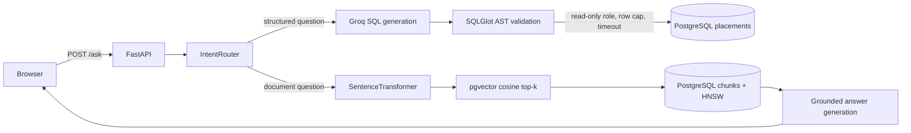

# Placement Copilot

A hybrid question-answering service over placement records and company/interview documents. Structured questions use generated SQL against PostgreSQL; document questions use vector retrieval followed by grounded generation.

## Architecture



`ask_api.py` is the web entry point. `ingest.py` chunks and embeds `.txt` files from `documents/`; `load_data.py` loads placement rows. Runtime retrieval uses read-only credentials. Ingestion uses the writer account.

## Local Setup

1. Use Python 3.9 or newer and install dependencies with `pip install -r requirements.txt`.
2. Copy `.env.example` to `.env`. Set unique secrets for `POSTGRES_PASSWORD`, `DB_PASSWORD`, `SQL_READONLY_PASSWORD`, and set `GROQ_API_KEY`. For the two read-only URLs, use the `rag_readonly` password URL-encoded and host `localhost`.
3. Start PostgreSQL: `docker compose up -d db`.
4. Load the sample placement data and document corpus:

   ```sh
   python load_data.py
   python ingest.py
   ```

5. Run the API: `uvicorn ask_api:app --host 127.0.0.1 --port 8000`.
6. Open `http://127.0.0.1:8000`. Liveness is `/health`; dependency readiness is `/ready`.

The API accepts `POST /ask` with `{"question":"..."}`. Questions are limited to 2,000 characters. The SQL result includes `generated_sql` only after AST validation.

## Configuration Notes

- `DATABASE_URL` can override the writer connection URL. Otherwise the writer URL is built from `DB_USER`, `DB_PASSWORD`, `DB_HOST`, `DB_PORT`, and `DB_NAME`.
- `RAG_READONLY_DB_URL` and `SQL_READONLY_DB_URL` use `rag_readonly`; the RAG URL defaults to the SQL URL if omitted.
- The database schema is fixed to 384-dimensional vectors. The configured embedding model is checked at startup and ingestion.
- The default RAG pool is 5 connections plus up to 10 overflow connections per engine process. The SQL engine has its own pool. Multiply by worker count when setting PostgreSQL `max_connections`.
- Compose binds PostgreSQL to loopback and persists data in the `pgdata` volume. Bootstrap SQL runs only when that volume is initialized for the first time. Do not remove a production volume to rerun initialization.

## Checks

```sh
python -m pytest -q test_sql_security.py
python -m compileall -q ask_api.py ingest.py load_data.py sql_security.py
```

## Readiness Caveats

This is a hardened local/demo baseline, not a complete internet-facing production deployment. There is no authentication or rate limiting, no formal migration framework, no pinned dependency lock, no metrics/tracing pipeline, and no representative retrieval/answer evaluation set. Add those before exposing student data outside a trusted environment. Use a TLS-terminating reverse proxy, managed secrets, backups, restore drills, and an explicit PII retention policy in deployment.

See [docs/INTERVIEW_GUIDE.md](docs/INTERVIEW_GUIDE.md) for the architecture walkthrough, trade-offs, likely follow-ups, and known limitations.
