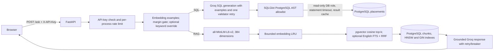

# Placement Copilot

Placement Copilot answers placement questions across structured records and company policy documents.
Exact counts and aggregates use guarded, read-only SQL; policy questions use vector retrieval and grounded generation.
The placement CSV is synthetic and the company documents are manually compiled project data.

```text
+--------------------------------------------------------+
| PLACEMENT COPILOT                         SAMPLE DATA   |
|                                                        |
| Ask: What CGPA does Google require?          [→]       |
|                                                        |
| Answer: Minimum CGPA is 8.0.                           |
| Source: google.txt                                      |
+--------------------------------------------------------+
```

## Architecture



`ask_api.py` is the served app. The SQL route reads only `placements` through the `rag_readonly` role; the RAG route searches `chunks` through the same read-only role. `load_data.py` and `ingest.py` use the writer credentials. `eval.py` has a fully offline mode and an optional live HTTP mode. `loadtest.py` is a concurrent HTTP measurement tool. Standalone examples and legacy demos are in `scripts/`.

## Run Locally

Use Python 3.9+ for the host-side loader/evaluator. Copy `.env.example` to `.env`, then set distinct values for `POSTGRES_PASSWORD`, `DB_PASSWORD`, `SQL_READONLY_PASSWORD`, `API_KEY`, and `GROQ_API_KEY`. Do not commit `.env`; Compose uses `db` as the container hostname while host scripts use `localhost`.

One-command sequence from the repository root, after `.env` is configured:

```sh
docker compose up --build -d --wait db && python load_data.py && python ingest.py && docker compose up --build -d --wait api
```

The database healthcheck gates the data load; `load_data.py` loads the synthetic placement rows and `ingest.py` chunks/embeds `documents/*.txt`. The API healthcheck then waits for `/health`. Open `http://127.0.0.1:8000` and enter the configured `API_KEY` in the UI field.

An early local development commit contained a fixed `ragpass` Docker/PostgreSQL default. The current working-tree configuration uses environment-only credentials; historical commits were intentionally not rewritten, so that old value remains visible in Git history.

The API accepts `POST /ask` with `{"question":"..."}` and `X-API-Key`. The question length is limited to 2,000 characters. Existing response keys remain; optional fields include `route_reason`, `timings_ms`, `request_id`, `cache_hit` or `embedding_cache_hit`, and degraded/error markers. `/health` checks the embedding model and both database connections; `/ready` performs the same dependency readiness checks. `/company-summaries` returns database-derived sample placement counts and average packages.

## Configuration

- `API_KEY` enables shared API-key authentication. It is not a user identity or row-level authorization system.
- `RATE_LIMIT_REQUESTS` and `RATE_LIMIT_WINDOW_SECONDS` configure a per-process, per-client-IP sliding window.
- `DATABASE_URL` can override the writer URL. Otherwise `DB_USER`, `DB_PASSWORD`, `DB_HOST`, `DB_PORT`, and `DB_NAME` form the writer connection.
- `RAG_READONLY_DB_URL` and `SQL_READONLY_DB_URL` use the read-only role; RAG defaults to the SQL URL if omitted.
- `EMBEDDING_MODEL` must emit 384-dimensional vectors to match the schema. `INGEST_BATCH_SIZE` controls embedding/write batch size.
- `RAG_TOP_K=3`, `RAG_DISTANCE_THRESHOLD=0.7`, and `HYBRID_RETRIEVAL_ENABLED=false` are the measured small-corpus defaults. Hybrid mode combines English full-text and vector ranks using reciprocal rank fusion.
- Intent routing embeds the 20 examples in each route once at startup and averages each route's top-three cosine similarities for a question. `ROUTER_MARGIN_THRESHOLD=0.08` is the measured tuning/held-out tradeoff; `ROUTER_KEYWORD_ENABLED=false` keeps the legacy keyword override off by default. Low-margin questions use the strict five-second LLM classifier fallback. `router_examples.json` is checked against tuning and held-out questions for exact and cosine >0.95 overlap by `test_router_examples.py`.
- The embedding LRU defaults to 512 entries. The SQL result cache defaults to 128 entries with a 30-second TTL. These are process-local caches.
- The default RAG database pool has 5 base connections and up to 10 overflow connections per process. Pools multiply by worker count and engine count.
- Compose binds host ports to loopback and stores PostgreSQL data in `pgdata`. `db/init.sql` is first-volume bootstrap SQL, not a versioned migration system. `ingest.py` performs idempotent additive index/schema checks before staging its replacement corpus.

## Measured Results

Live answer figures use a 35-question set, 12 document files, and the 600-row synthetic CSV. They are single local runs against a rate-limited external LLM provider; answer accuracy can vary between runs. SQL accuracy is exact result comparison; RAG accuracy checks expected source plus required facts using token-normalized text matching. Ambiguous cases are excluded from router accuracy.

| Metric | Baseline live | Latest full live snapshot | Measurement notes |
|---|---:|---:|---|
| Router accuracy | 30/33 (90.91%) | 32/33 (96.97%) | Latest full run was `after_observability`; later provider-resilience changes were verified with simulated failures and offline eval because the provider reached TPM limits. |
| SQL answer accuracy | 9/15 (60.00%) | 12/15 (80.00%) | Small sample; LLM-generated SQL varied across runs. |
| RAG answer accuracy | 12/15 (80.00%) | 13/15 (86.67%) | Single live run per set. |
| Live source recall@3 | 16/17 (94.12%) | 15/17 (88.24%) | Includes route errors and one request failure; retrieval-only PostgreSQL sweep reached 17/17 for vector and hybrid modes. |
| Full API p50 / p95 | 761 / 4,879 ms | 823 / 5,686 ms | HTTP client-observed duration; external provider dominates tail latency. |
| Retrieval-only `/ask` p95, caches off → on | Not measured | 175 / 68 / 157 → 142 / 31 / 45 ms at 1 / 10 / 25 clients | Threshold set to zero to skip Groq generation; local load run, one request per client. |
| `/health` p95 before → after dependency checks | 6.5 / 4.2 / 7.4 ms | 26 / 25 / 41 ms at 1 / 10 / 25 clients | Added two DB pings and model-loaded check; health latency intentionally increased. |

### Router Results

Measured with `eval.py --router-analysis-only` and `--router-live-fallback`; evidence is in `results/eval_results_router_final_offline.json` and `results/eval_results_router_final_live.json` (2026-11-01). Router accuracy excludes the two mixed-intent tuning cases; fallback rate uses all questions in that split.

| Split | Mode / margin | Accuracy | LLM fallback rate |
|---|---|---:|---:|
| Tuning (33 scored) | Keyword-only | 30/33 (90.91%) | N/A |
| Tuning (33 scored) | Embedding-only | 30/33 (90.91%) | 0% |
| Tuning (33 scored) | Embedding + LLM, 0.02 | 30/33 (90.91%) | 2/35 (5.71%) |
| Tuning (33 scored) | Embedding + LLM, 0.05 | 30/33 (90.91%) | 3/35 (8.57%) |
| Tuning (33 scored) | Embedding + LLM, 0.08 | 32/33 (96.97%) | 8/35 (22.86%) |
| Tuning (33 scored) | Embedding + LLM, 0.12 | 32/33 (96.97%) | 15/35 (42.86%) |
| Held-out (15) | Keyword-only | 10/15 (66.67%) | N/A |
| Held-out (15) | Embedding-only | 15/15 (100%) | 0% |
| Held-out (15) | Embedding + LLM, 0.02 | 15/15 (100%) | 0/15 (0%) |
| Held-out (15) | Embedding + LLM, 0.05 | 15/15 (100%) | 1/15 (6.67%) |
| Held-out (15) | Embedding + LLM, 0.08 | 15/15 (100%) | 1/15 (6.67%) |
| Held-out (15) | Embedding + LLM, 0.12 | 15/15 (100%) | 3/15 (20.00%) |

Threshold `0.08` was selected: it matches the best observed tuning accuracy while using half the fallback rate of `0.12`. Held-out accuracy is higher than tuning in this sample; this 15-question set does not establish a generalization guarantee.

### Router Comparison

These are router-only measurements on 35 tuning questions and 15 held-out questions. Fallback rate is the fraction with embedding margin below the threshold; LLM-fallback accuracy includes the live classifier result, with fallback failures defaulting to RAG. Evidence: `results/eval_results_router_offline.json` and `results/eval_results_router_live.json` (2026-11-01).

| Split | Mode / margin | Accuracy | LLM fallback rate |
|---|---|---:|---:|
| Tuning | Keyword-only | 30/33 (90.91%) | N/A |
| Tuning | Embedding-only | 30/33 (90.91%) | 0% |
| Tuning | Embedding + LLM, 0.02 | 30/33 (90.91%) | 5.71% |
| Tuning | Embedding + LLM, 0.05 | 30/33 (90.91%) | 8.57% |
| Tuning | Embedding + LLM, 0.08 | 32/33 (96.97%) | 22.86% |
| Tuning | Embedding + LLM, 0.12 | 32/33 (96.97%) | 42.86% |
| Held-out | Keyword-only | 10/15 (66.67%) | N/A |
| Held-out | Embedding-only | 15/15 (100%) | 0% |
| Held-out | Embedding + LLM, 0.02 | 15/15 (100%) | 0% |
| Held-out | Embedding + LLM, 0.05 | 15/15 (100%) | 6.67% |
| Held-out | Embedding + LLM, 0.08 | 15/15 (100%) | 6.67% |
| Held-out | Embedding + LLM, 0.12 | 15/15 (100%) | 20.00% |

Threshold `0.08` was selected: it matches the best observed tuning accuracy while using half the fallback rate of `0.12`. Held-out accuracy is higher than tuning in this small sample; this is not evidence that held-out generalization is generally superior.

Retrieval sweep (`results/eval_results_retrieval_sweep.json`): at `top_k=3`, threshold `0.7`, vector-only and hybrid each achieved 17/17 source recall, 17/17 retrieved-context fact coverage, and 3/3 abstention accuracy. In the measured run, vector-only retrieval p50/p95 was 0.929/2.581 ms, versus 2.015/4.258 ms for hybrid. Thresholds 0.6–0.8 tied on the fixture set; 0.5 lowered accepted-source recall and 0.9 lowered abstention accuracy. Vector-only remains the default. A cross-encoder was not added because this eval showed no factual-recall headroom.

## Design Decisions and Tradeoffs

- **Embedding router:** 20 examples per route are embedded once at startup; the mean of each route's top-three cosine similarities is compared, and a margin below 0.08 invokes the strict LLM fallback. The keyword router is opt-in for comparison, not the default. This uses model examples to cover paraphrases but adds startup/model maintenance and can still route semantically similar out-of-scope questions incorrectly.
- **pgvector in PostgreSQL:** placement records and document vectors share the same database and role model, reducing service count and simplifying local deployment. The small 22-chunk sweep does not establish large-corpus index performance.
- **Abstention threshold:** cosine distance over `0.7` abstains in the measured default. The local sweep tied at thresholds 0.6–0.8, so 0.7 was retained; distance is not a calibrated probability.
- **No reranker:** at the measured top-k/threshold, vector-only already covered all 17 source cases and required facts. A cross-encoder added latency and dependencies without demonstrated fixture-set gain.

For detailed per-case outputs, see [results/README.md](results/README.md), which indexes all evaluation, cache, load, and EXPLAIN artifacts by date and code state.

## Checks

```sh
python -m pytest -q
python -m compileall -q .
python eval.py --name offline
LOADTEST_API_KEY="$API_KEY" python loadtest.py --name local
```

GitHub Actions runs tests and offline evaluation on pushes and pull requests.

## Known Limitations

- Authentication is one shared API key; there is no per-user identity, authorization, or row-level PII access policy. SQL PII columns are denied by default, but enabling `SQL_ALLOW_PII_COLUMNS` allows the configured identifiers.
- The in-memory rate limiter, caches, and circuit breaker are per process; they do not coordinate across multiple workers or replicas.
- Embedding routing is measured on 35 tuning and 15 held-out examples; this is still a small sample. Low-margin fallback calls depend on Groq, default to RAG on failure, and mixed questions are still routed to one branch only.
- Groq provider TPM limits were reached during repeated evaluation runs. The committed latest full live metrics predate the final provider retry/circuit-breaker changes; final live answer accuracy under those changes is not measured.
- The retrieval sweep uses only 17 source cases and 3 out-of-scope cases over 22 chunks. It does not establish production-scale recall, HNSW behavior, or general answer quality.
- `synthetic_placements.csv` is generated sample data. The company-document files are manually compiled and not verified by an external data feed.
- Docker Compose config was validated, but the API image build could not be completed because Docker Desktop's daemon disconnected mid-build. Model download/storage behavior in a built API container is therefore unverified.
- The bootstrap SQL is not a versioned migration framework. Backups, restore drills, TLS ingress, centralized logs/metrics/traces, and a real-data retention/deletion policy are deployment responsibilities not implemented here.
- The full SQL allowlist is intentionally narrow. It can reject valid generated queries; the live evaluation includes rejected outputs and date wording mismatches.

See [docs/INTERVIEW_GUIDE.md](docs/INTERVIEW_GUIDE.md) for design details and the interview walkthrough, and [INTERVIEW_REPORT.md](INTERVIEW_REPORT.md) for measured hardening changes and interview questions.